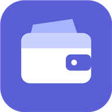
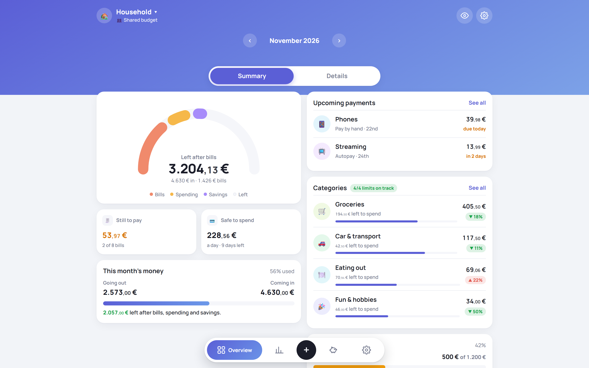
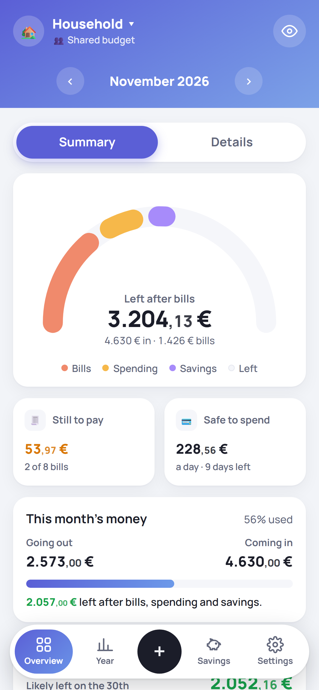
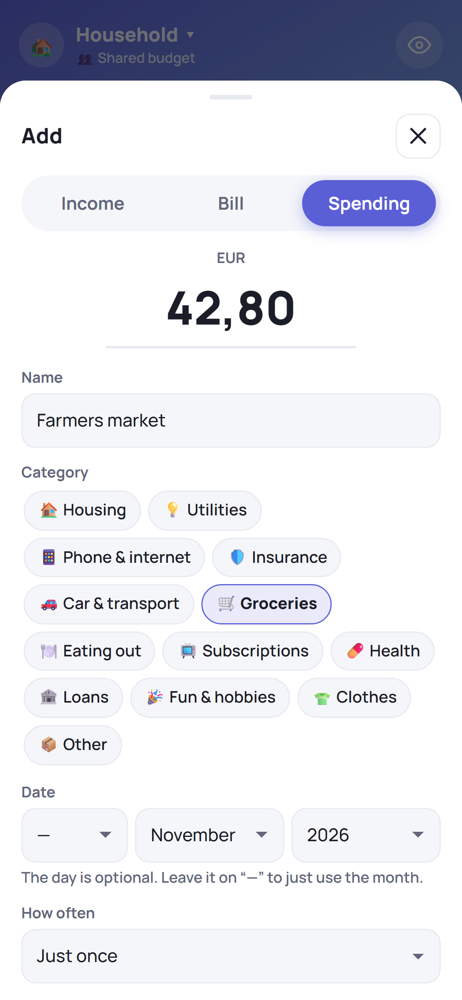
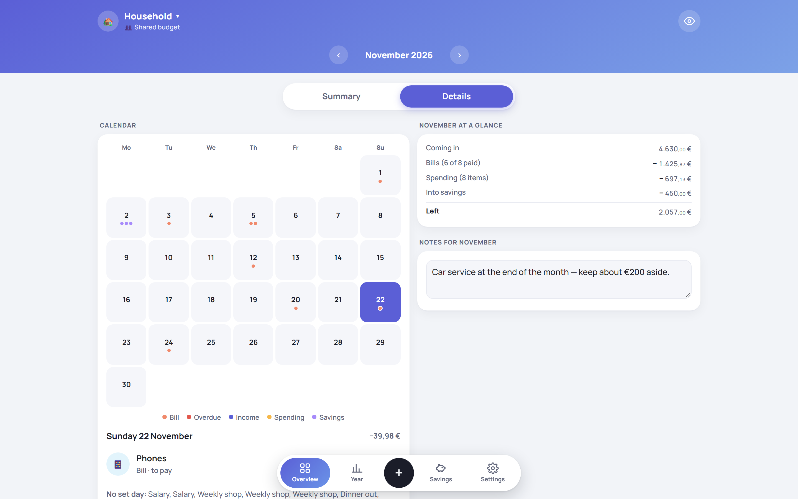
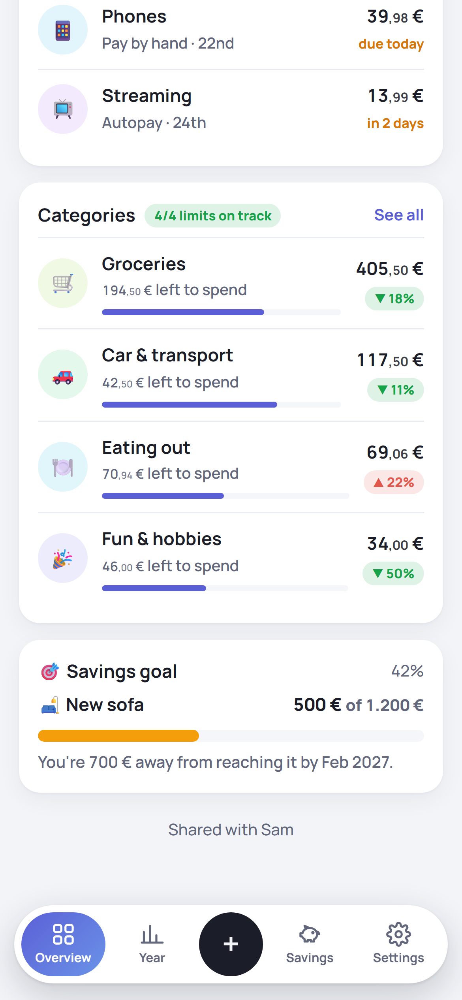
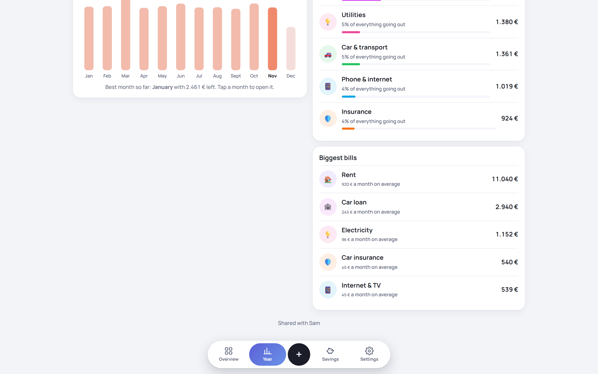
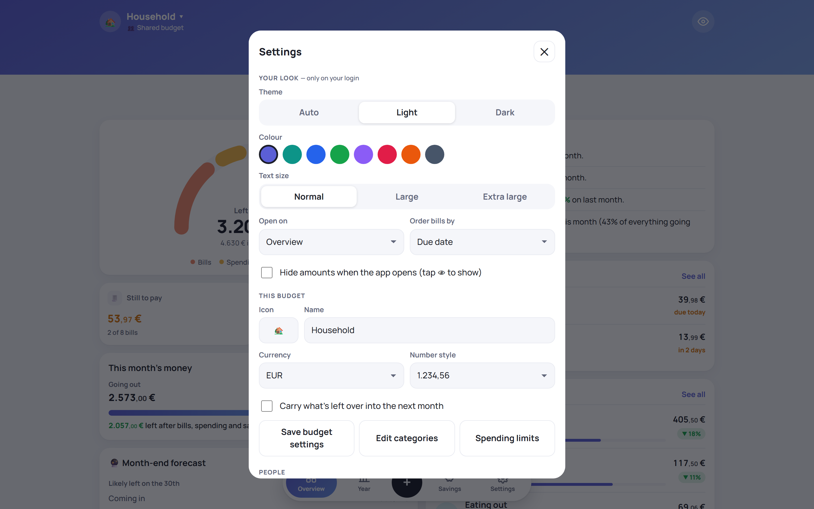
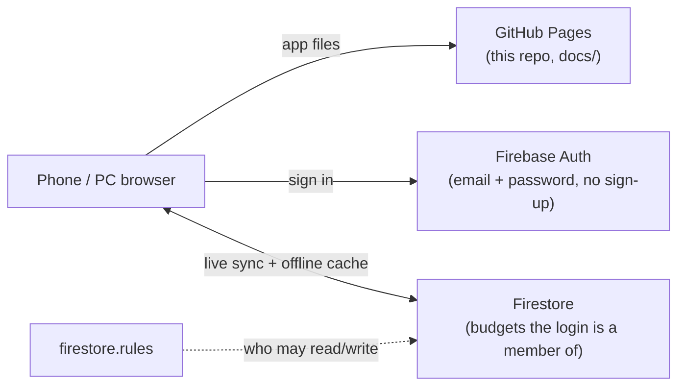

# Budget

**A private, good-looking budget for the whole family.**
Enter your income and bills once, tick them off as you pay, and always know what's left.

[**Open the app**](https://davitos223.github.io/budget-app/)

 

  

&nbsp;
&nbsp;
&nbsp;

Screenshots use made-up demo data.

---

## Contents

- [Features](#features)
- [A tour of the app](#a-tour-of-the-app)
- [Getting the app](#getting-the-app)
- [Sharing a budget](#sharing-a-budget)
- [Updates](#updates)
- [Your data and privacy](#your-data-and-privacy)
- [How it works](#how-it-works)
- [For developers](#for-developers)

## Features

- **Left after bills, at a glance.** One big number, plus income, bills, spending, savings and what's left after everything.
- **Enter bills once.** Choose how often each one comes (every month, every 2, 3 or 6 months, every year, or just once), and optionally when it ends. It appears in every month on its own.
- **Tick bills off.** Direct debits (*Autopay*) tick themselves on their due day.
- **Upcoming payments** show "today", "in 2 days" or "3 days late", with overdue and due-soon warnings.
- **Insights** in plain words from your own numbers, led by where the month is heading ("You're on track to finish November with €2.052 left"), then things like "Groceries: €89 less than last month", "Everything going out is down 6%", "You're at 92% of your Eating out limit".
- **Month-end forecast:** what's likely left on the last day, based on your usual spending for the rest of the month.
- **Calendar** (in Details): every bill, payday, purchase and savings move on its day. Overdue bills show in red; tap a day to see what's on it.
- **Plan for next year's bills:** adds up every bill for next year (which months the irregular ones fall in, too) and tells you how much to put aside each month to have it all by a date you pick — or what they cost spread over the year. One tap turns it into a savings goal like "Bills 2027".
- **Activity history:** every change is recorded with who did it and when ("Sam added spending Weekly shop €128,40", "Mum ticked Rent as paid"). Shared budgets show the latest on the Summary; Settings → *Activity history* has everything. Nobody can edit or delete it.
- **Optional dates:** give anything a day as well as a month (a due day, a pay day or the date of a purchase), or just pick the month. Day, month and year are dropdowns, so there's nothing to type.
- **Fill in earlier months:** started mid-year? One tap counts your current income (and bills) in the months before, so past months and the Year view are right. Past bills are ticked as paid.
- **Just this month:** change a bill's amount or skip it for one month without touching the others.
- **Spending limits** for each category, e.g. "€194 left of €600", with "You're doing great 👍", "Getting close" or "Over by …".
- **Savings goals** with a target and a date, "+€150 this month" on each card and a last-6-months chart inside. The app works out how much to put aside each month, and money you put in counts in that month's budget.
- **The year at a glance:** income per month, going out per month (bars), what's left over, the best month, categories and the biggest bills.
- **Private budgets for everyone**, plus optional **shared** ones (e.g. "Household") that show who added what.
- **Make it yours:** theme, 8 colours, 3 text sizes, the page it opens on, bill order, hide-amounts mode, currency and number style, editable categories, carry-over.
- **Backups:** download or restore a backup, and export a year to Excel (CSV).
- Works on phone and PC, installs to the home screen, and keeps working offline.

## A tour of the app

### Overview

Each month has two tabs. **Summary** shows only what matters first:

- The **gauge** shows **left after bills** in the middle. Its arc fills with bills, spending and savings, and the grey part is what's still free.
- **Still to pay** and **safe to spend** per day for the rest of the month.
- **This month's money:** one bar for going out against coming in.
- The next **3 upcoming payments**, your **top categories** (with their limits) and **one savings goal**.

**Details** has the full lists: bills, spending, income, savings, who added what, and notes. The floating bar at the bottom switches between Overview, Year and Savings. Its **+** adds something new.

### Bills and upcoming payments

&nbsp;

Tap the circle to mark a bill as paid. Bills on *autopay* tick themselves on their due day. Bills that are overdue or due soon get a coloured tag, and the **Upcoming payments** card lists what's left to pay this month. Tap any bill to edit it, change it just for this month, skip it, or stop it from a month on while keeping its history.

### Spending limits

&nbsp;

Give categories such as Groceries or Eating out a monthly limit. The summary shows "€194 left to spend" with a thin bar and the change against last month for each category. **See all** lists every category. When you set a limit, the app shows your average for the last three months so you can pick a realistic number.

### Adding things

The **+** button adds spending, a bill or income: a big amount, the name, a row of categories you can swipe through, and the date. Repeat-until and notes sit under *More options*. Amounts work with a comma or a dot. The date is optional: pick a day, month and year, or leave the day on “—” to just use the month.

If a month has no income yet because you only started using the app later, the month shows a **Fill in from your current income** button. The same tool is under **Income → Earlier months**.

### The year

Income against bills and spending for every month (faded bars are months still to come), what's left over for the year, the average per month, the best month, where the money went by category, and the biggest bills. Tap a month to open it.

### Savings goals

Make a goal for a holiday, a new sofa or an emergency fund. Each card shows one number, one bar and **+ Add money**. Tap a card to take money out, see its history and how much to put aside each month, or edit it. Money you put in shows up in that month's budget.

### Settings and themes

&nbsp;

**Your look** (only on your own login): Auto, Light or Dark theme, 8 colours, Normal, Large or Extra large text, which page the app opens on, bill order, and *hide amounts* (the 👁 button blurs every number, which is handy in public).
**Each budget:** name and icon, currency, number style, categories with your own emoji, spending limits, and carrying leftovers over to the next month.

## Getting the app

### Phone

1. Open **https://davitos223.github.io/budget-app/** and sign in with the login you were given.
2. Add it to the home screen:
   - **iPhone (Safari):** Share button → *Add to Home Screen*.
   - **Android (Chrome):** ⋮ menu → *Add to Home screen* / *Install app*.

It then opens full screen like a normal app.

### Computer

Open the same link in any browser. In Edge or Chrome you can also use *Install app* in the address bar to give it its own window.

## Sharing a budget

Everyone gets a **private** budget the first time they sign in. Nobody else can ever be added to it.

To plan something together:

1. Tap the budget name at the top → **New shared budget** (e.g. "Household").
2. The other person: **Settings → Your account → Copy code**, and send you the code.
3. You: **Settings → People** → paste the code and their name → **Add person**.

Only the person who created a shared budget can add or remove people or delete it. Anyone can leave a budget they were added to.

## Updates

The app is served straight from this repository, so every change goes live within a few minutes. Phones pick it up the next time the app is opened (sometimes it takes two openings). The version number is shown at the bottom of Settings.

## Your data and privacy

- **Logins only.** You can't create an account yourself; the owner adds each person.
- **Every budget has its own list of people**, and the database rules let only those people read or write it. Without a login, everything is refused.
- **Private stays private.** A personal budget can never get extra members.
- Your look settings belong to your login only.
- **No budget data is in this repository.** It only holds the app's code.
- The app has no ads, no analytics and no tracking.
- **Backups:** Settings → *Download backup* saves everything in a budget to a file, and *Restore backup* brings it back.

## How it works

- `docs/index.html`: the whole app (one page, no build step).
- `docs/cloud.js`: sign-in and sync through Firebase, with an offline cache.
- `docs/config.js`: which Firebase project to use (set it to `null` for demo mode, where data stays in the browser).
- `docs/sw.js`: service worker. It always tries the newest version first and falls back to the saved copy when offline.
- `firestore.rules`: the access rules (members only, private budgets stay private, only the owner manages people).

Data layout: `budgets/{id}` (name, kind, owner, members, currency, categories, limits) holds `entries` (income, bills, spending), `months/{YYYY-MM}` (paid ticks, one-month amounts, skips, notes) and `goals`. Each person's look settings live in `users/{uid}`.

## For developers

- **Run locally:** `py -3.12 -m http.server 5174 --bind 127.0.0.1 --directory docs`, then open <http://localhost:5174>. This uses the real project, so add **`?demo`** (<http://localhost:5174/?demo>) for a demo mode that never touches it. Demo mode only works on localhost.
- **Tests:** `node tools/test.mjs` runs 84 checks of the money maths on a demo copy (never the real database). Run it before every release.
- **How it's built:** see [ARCHITECTURE.md](ARCHITECTURE.md) for the data, the calculation rules and the access rules.
- **Screenshots:** `node tools/screenshots.mjs` (Node 22+ and Edge or Chrome) rebuilds everything in `screenshots/` from a demo copy with invented data. Never use a real budget for screenshots.
- **Releases:** bump the version in **three places together**: `APP_VERSION` in `docs/index.html`, the `?v=` on the `config.js` / `cloud.js` script tags, and `version:` in `docs/cloud.js`.
- **Firebase setup** (only for a new project): Email/Password sign-in with *create (sign-up)* and *delete* turned off, Firestore in production mode with `firestore.rules` published, and the browser API key restricted to the site's addresses (`davitos223.github.io/*`, `localhost:5174/*`, `<project>.firebaseapp.com/*`).
